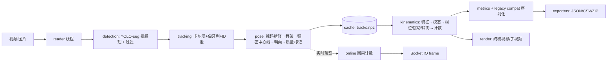

# 线虫运动分析系统 · 全栈重构计划 v2 (Reconstruction Plan)

> **状态**：✅ 决策已全部锁定（含 D12：源分辨率）。**详细实现规格见 [docs/spec/](docs/spec/00_README_FOR_IMPLEMENTER.md)**，本文件是总览与决策记录。
> **版本**：v2（推翻 v1 重写；v1 已归档于 [docs/archive/PLAN_v1.md](docs/archive/PLAN_v1.md)）
> **铁律**：① 不改动原项目任何文件；② 所有新文件只放在 `re_struction/`；③ 新旧系统可并行运行、可 A/B 对比，验收通过后才切换。

---

## 0. 为什么推翻 v1

| v1 的问题 | 说明 |
| :--- | :--- |
| 范围过窄 | 只重写 `worm_processing.py`，保留 `app.py`(1356 行)、`App.js`(1519 行) 原样；而二者同样是巨型单文件、全局变量耦合。 |
| 相位展开的"净积分为 0"论断不严谨 | ① 往返爬行（前进→后退）的净相位互相抵消，会**漏计**；② 振幅接近 0 时相位无定义，`unwrap` 会把噪声累积成虚假圈数，**反而过计**；③ 固定 $\cos(2\pi s)$ 基底隐含"波长=体长"，实际爬行/游泳波长不同。 |
| 把体长异常当"伪影"的问题只改了一半 | 应把「姿态无效」与「姿态异常」解耦，并改用**面积**（弯曲时近似守恒）而非骨架长度判断粘连。 |
| 只有 11 个点 | 相位/曲率分析分辨率不足；应内部用稠密中心线，对外再抽 11 点兼容 UI。 |
| 没有真值与验收标准 | 没有标注数据，"调到对"无从判断。 |
| 没有测试/配置/数据层规划 | 无合成数据、无回归基准、无配置分层。 |

---

## 1. 现状审计（事实，非猜测）

### 1.1 规模与结构
| 文件 | 行数 | 职责混杂情况 |
| :--- | ---: | :--- |
| `backend/worm_processing.py` | 2551 | YOLO 封装、骨架、3 代计数逻辑并存、卡尔曼、匈牙利匹配、ID 池、绘制、子视频、批处理入口 |
| `backend/app.py` | 1356 | Flask 路由、Socket.IO、多进程任务、4 线程流水线、模型缓存(全局变量)、虫卵计数、CSV/JSON/ZIP 导出 |
| `frontend/src/App.js` | 1519 | 4 个组件 + 约 40 个 `useState` 全塞在 `App()`；`io('http://localhost:5000')` 硬编码 |

### 1.2 运行环境事实
- Python 3.12.10；**本机 GPU：RTX 5070 Ti（16 GB，Blackwell）**，但 `backend/venv` 里 torch 是 **CPU 版（`cuda=False`）**——现有 venv 实际在用 CPU 推理。新环境需安装 **CUDA 12.8+ 构建的 PyTorch**（Blackwell 架构要求），P0 实测。
- 模型：`origin.pt` = YOLO-seg，单类 `item`，**训练 imgsz=416**；`CJLUdata_Old.pt` = 单类 `worm`，imgsz=1024。现有推理代码**未传 `imgsz`**（默认 640），1080p 帧被降采样到 640，细长虫体细节损失明显——这是影响精度的独立因素，见 D12。
- 14 个样例视频（`backend/uploads/`），全部 1920×1080 @ ~30 fps，时长 21–34 s：`Move-3`（爬行）、`Swim-1/3/4`（游泳）、`1.6X1/1.6X3`、`10/10-2/10-3/20/32`、`2day-1/2day-4`、`4day-1`。
- 现有关键点每 3 帧提一次（`KEYPOINT_UPDATE_INTERVAL=3`），等效仅 **10 Hz**。

### 1.3 现有代码的主要坏味道（重构需消除）
1. `app.py` 用 `globals().get('global_model_path')`、全局模型缓存；`/select_model` 改全局会影响正在预览的请求。
2. `process_frame` / `process_frame_batch` / `process_track_single` 三份近乎重复。
3. 图片分支与视频分支在 `process_video_task` 里重复约 150 行。
4. `cycle_counts` 里 **20+ 个同义别名键**（`swings/swing_count/cycle_count/inst_freq/...`），仅为历史兼容。
5. `cycles = c + s`、`avg_freq = (c+s)/观测秒数` 语义混淆（C 与 S 物理意义不同，不应直接相加成"频率"）。
6. 同名上传文件会互相覆盖（`secure_filename` 后直接保存）；`SECRET_KEY` 硬编码。
7. `README.md`、`test_track_history.py` 存在 GBK/UTF-8 乱码；`requirements.txt` 无版本锁定；`celery/redis` 声明但未使用。
8. 所有阈值是模块级常量，**无环境（琼脂爬行 vs 液体游泳）分档**。

### 1.4 必须冻结的外部契约（新前端/旧前端都能用）
**REST**：`POST /upload` · `POST /analyze_first_frame` · `POST /extract_manual_worm` · `POST /preview_count` · `GET /download/<f>` · `GET /media/<f>` · `GET /task/<id>/status|sub_videos` · `POST /task/<id>/pause|resume|cancel|set_worm_count` · `GET /models` · `POST /select_model` · `POST /egg_count` · `GET /sub_video/<id>/<f>`
**Socket.IO**：客户端 `join{task_id}`；服务端事件 `frame{task_id,frame,total_frames,image(b64 jpg),stats{frame,active_tracks,tracks[]}}` · `complete{video_url,log_url,sub_videos_url,summary_url,csv_url,id_pose_summary[]}` · `cancelled` · `error`
**track 对象字段**（前端表格直接读取）：`track_id,user_label,c_count,s_count,is_bidirectional,motion_type,activity_score,is_static,is_ghost,lost_frames,live_freq,avg_freq,cycles,swings,bends_per_min,centroid_bl,head_bl,head_kpt_idx,keypoints_bl`
**id_pose_summary 字段**：上列 + `spatial_stats{total_path_length_px,net_displacement_px,start/end_centroid_bl,bbox_coverage_bl}`
**upload 表单**：`video,worm_count(必填正整数),head_config(JSON),model_name`；`head_config[i]={det_idx,head_kpt_idx,user_label,bbox,keypoints}`

> 策略：新系统内部用干净的新字段（见 §4），在 `compat/legacy_payload.py` 里**单点**生成旧别名字段。以后可整体删除 compat 层。

---

## 2. 目标 / 非目标

**目标**
- G1 C 形、深弯、游泳摆动能被**稳定**识别，不再"越弯越被丢弃"。
- G2 S 计数由**行波物理量**驱动，对抖动、原地摆头免疫；偏大问题可量化验证。
- G3 全部时间参数以**秒**为单位，随 FPS 自适应；阈值按环境分档（`crawl_agar` / `swim_liquid`）。
- G4 算法库与 Web 层彻底解耦，可在无 Flask 环境下离线跑、单测、画诊断图。
- G5 有**真值基准 + 合成数据 + 回归测试**，每次改参数都能量化对比。
- G6 前后端契约冻结，新旧可并行运行、逐步切换。

**非目标**：不训练新检测模型（见 D3-C 为远期选项）；不解决严重多虫重叠的拆分（仅检测并静默）；不改 UI 视觉风格。

## 2.1 业务定义（甲方确认，验收口径）

| 动作 | 定义 |
| :--- | :--- |
| **一次 S**（爬行） | 全身完成**一个完整正弦波（上-下-上）**，波传播方向一致，**并朝该方向发生净位移**才计 1 次。只有头部轻微上下（试探/寻路）**不算**。 |
| **向后 S** | **完全不统计**（仅诊断字段 `rejected.backward`）。 |
| **反向运动** | **本轮相位进度回退为负 且 质心沿体轴实际后退**（两条同时成立）→ 作废**当前未完成的半截周期**，**已完成的 S 保留**。 |
| **一次 C** | **两种口径同时输出**：`c_cycles`（左弯+右弯完成一个完整来回=1）与 `c_bends`（左、右每次单向弯曲各算 1）；`c_unit` 选择哪一种作为 `c_count`，前端可即时切换，默认周期。 |
| 爬行视频的真值数字 | = 向前 S 次数（C 不计入验收） |
| 游泳视频的真值数字 | = 游泳摆动次数（评测同时给两种口径，由甲方定哪种对应） |
| 范围 | 整段视频；**后进入画面的虫一律不计数**（轨迹实例首次出现帧 > 1.0 s 即视为后进入，默认不进汇总，画面灰框标注） |
| 推理分辨率 | **尽可能用源分辨率**（imgsz=native=1920）；此前降到 640 是上一任代码计数偏低的权宜之计 |

对算法的直接约束：
1. S 必须同时满足 **(a)** 全身行波（后半身也有同频摆动，排除头部试探）**(b)** 相位单调推进满 2π **(c)** 向前且位移方向与波方向一致（见 spec 03 §4）。
2. 游泳 C 需**逐帧**取姿态（Swim 约 1.2–3.3 次/秒，旧系统 10 Hz 会欠采样）。
3. Swim 视频里虫体极小（约 15–60 px）且有强反光 → 姿态层 ROI 放大后再骨架化；源分辨率推理有利于小虫。
4. 只统计向前 S 使**头尾朝向正确性**变得更重要（见 spec 03 §11-4）。

## 2.2 参考真值（`referAnswer/`，已整理为 `benchmarks/ground_truth.yaml`）
| 视频 | 真值（编号→次数） | 备注 |
| :--- | :--- | :--- |
| 10×（= uploads/10.mp4） | 0→2, 1→0, 2→1, 3→0, 4→2, 5→4, 6→1, 7→1 | 编号图 `numbering_10x.jpg`，画面里还有大量未编号虫（不计） |
| 1.6X-1（= 1.6X1.mp4） | 1→0, 2→2, 3→0, 4→0, 5→0, 6→2, 7→0, 8→0 | **6/8 为 0，用来检验"不过计数/不把试探当 S"** |
| 1.6X-3（= 1.6X3.mp4） | 1→0, 2→3, 3→16, 4→2 | 手写纸为准（count.txt 的 73/716 是把箭头"⇒"读成了 7） |
| Swim-3 | 73, 33, 39（3 只，编号对应待 P0 用检测首帧确认） | 画面第 0 帧仅可见 2 只，第 3 只可能后进入——后进入者不计 |
| Swim-4 | 29（1 只） | 单只，极小 |

---

## 3. 目标架构



### 3.1 目录树（全部位于 `re_struction/`）
```text
re_struction/
├── RECONSTRUCTION_PLAN.md          # 本文件
├── docs/
│   ├── archive/PLAN_v1.md          # 已归档
│   ├── API_CONTRACT.md             # 冻结的 REST/Socket 契约 + TS 类型（已完成）
│   └── spec/                       # ★ 给实现者的伪代码级规格（已完成）
│       ├── 00_README_FOR_IMPLEMENTER.md   # 规则 + 任务清单 T01–T34
│       ├── 01_SPEC_core.md · 02_SPEC_pose.md · 03_SPEC_kinematics.md · 04_SPEC_tracking.md
│       ├── 05_SPEC_pipeline_server.md · 06_SPEC_frontend.md · 07_SPEC_tests_benchmarks.md
│       ├── reference/proto_kinematics.py  # 已跑通的 S 计数参考原型
│       └── DECISIONS.md · OPEN_QUESTIONS.md
├── backend/
│   ├── requirements.txt            # 版本锁定
│   ├── run.py                      # 启动入口
│   ├── config/
│   │   ├── default.yaml            # 全局默认
│   │   └── profiles/{crawl_agar,swim_liquid}.yaml
│   ├── wormlab/                    # ★纯算法库：不 import flask / socketio
│   │   ├── schemas.py              # Detection / Pose / TrackState / MotionReport 数据类
│   │   ├── config.py               # yaml → dataclass，时间量统一为秒
│   │   ├── detection/{detector.py, filters.py}
│   │   ├── pose/
│   │   │   ├── mask_refine.py      # (可选) 掩码与局部自适应阈值融合，抑制边缘锯齿
│   │   │   ├── skeleton.py         # 骨架化、DT 加权剪枝、环路/空洞处理
│   │   │   ├── centerline.py       # 测地最短路 → 弧长重采样(稠密N=33) → 端帽长度修正
│   │   │   ├── orientation.py      # 头尾朝向连续性（全序列距离 + 用户头标记）
│   │   │   └── quality.py          # OK / SUSPECT / BAD 判定（面积比、分叉、合并证据）
│   │   ├── tracking/{kalman.py, cost.py, associator.py, id_pool.py, reid.py, tracker.py}
│   │   ├── kinematics/
│   │   │   ├── features.py         # 切线角、体长、弦长比 R、质心速度
│   │   │   ├── modes.py            # 模态投影 a1,a2,c（含可选 eigenworm 基）
│   │   │   ├── wave.py             # 行波判别 ε + 相位展开 + 分段计圈（S）
│   │   │   ├── swing.py            # 对称摆动周期（C1，液体游泳）
│   │   │   ├── turns.py            # 深弯/Omega 折返（C2，迟滞）
│   │   │   ├── behavior.py         # 逐帧行为状态：static/crawl/thrash/turn/invalid
│   │   │   ├── counter.py          # 统一入口：流式 push() 与批量 run() 同一套代码
│   │   │   └── metrics.py          # 频率、活性、bends/min、空间统计
│   │   ├── render/{overlay.py, fonts.py, subvideo.py, video_io.py}
│   │   ├── pipeline/{stages.py, pass_a.py, pass_b.py, cache.py}
│   │   └── compat/legacy_payload.py
│   ├── server/
│   │   ├── app_factory.py · sockets.py        # FastAPI + python-socketio(ASGI)
│   │   ├── routes/{upload.py, preview.py, task.py, media.py, models.py, egg.py}
│   │   ├── tasks/{manager.py, worker.py, state_store.py(内存+结束落盘JSON), events.py}
│   │   └── exporters/{summary_json.py, csv_report.py, zip_pack.py}
│   └── services/{egg_count.py, model_registry.py}
├── frontend/                       # 见 §7（Vite + TS）
├── tests/{unit, synthetic, integration, golden}/
├── tools/
│   ├── diagnose_track.py           # 单轨迹诊断图：a1/a2 相平面、Φ(t)、c(t)、R(t)、ε(t)
│   ├── make_synthetic.py           # 合成线虫生成器（见 §8.2）
│   ├── compare_legacy.py           # 只读导入旧 backend/，同视频对比新旧计数
│   ├── label_events.py             # 逐帧/逐事件人工标注小工具（可选）
│   └── bench.py                    # 吞吐/耗时基准
├── benchmarks/{ground_truth.yaml(已完成), labels/*.json}   # 真值（§8.3）
└── data/{results, cache}/          # 运行产物，gitignore
```
> 模型/视频复用原目录：`config` 里 `models_dir: ../backend/models`、`uploads_dir: ../backend/uploads`（只读引用，避免复制 54MB+ 权重与 ~800MB 视频）。切换时再迁移。

---

## 4. 核心数据模型（`schemas.py`）

```python
Pose:      dense (N=33,2) float32 · pts11 (11,2) · length · chord · width_mean · area
           quality: Enum{OK, SUSPECT, BAD} · flags: set{"merge","loop","clipped","empty"}
TrackState: id · bbox · kalman_state · user_label · head_kpt_idx · is_ghost · lost_frames
MotionReport(per track): s_cycles(float) · s_count(int) · c_swing_cycles · c_turns · c_count
           mode_time{static,crawl,thrash,turn,invalid}(sec) · wave_index ε · freq_s_hz · freq_c_hz
           activity · direction_stats{forward,backward} · spatial_stats
```
- **float 优先**：内部保留小数周期（如 3.6 圈），UI/兼容层再取整，避免"差 0.1 圈"导致整数跳变。
- `c_count` 与 `s_count` **不再相加成"频率"**；兼容层的 `cycles/avg_freq` 仍按旧定义输出，同时新增 `freq_s_hz / freq_c_hz`。

---

## 5. 核心算法设计

### 5.1 姿态层（解决 C 形"识别不出来"的根因）
1. **掩码精修（可选，⚖️ D3-B）**：YOLO `mask_ratio=4` 的掩码边缘有 1–2px 起伏。在 ROI 内用局部自适应阈值与 **YOLO 掩码膨胀 2px** 求交，得到更锐的边缘；失败则回退原掩码。
2. **骨架 + 测地最短路（替代 BFS 最长路 + 分支熔断）**
   - `skeletonize` 后用 **距离变换 DT** 做剪枝：删去长度 < `k·局部半宽` 的毛刺（相对宽度，而非固定像素）。
   - 端点 = 骨架图直径的两个端点（两次 Dijkstra），路径代价用 `1/(DT+ε)` 使路径居中；**不再因"分支像素 > 18%"整帧丢弃**。
   - 掩码有空洞（Ω 弯自接触）→ 先填洞再骨架化；记 `loop` 标记，不丢弃。
3. **稠密中心线 + 端帽修正**：沿弧长重采样为 N=33 点；骨架比真实虫体两端各短约一个半宽，用端点处 DT 值延长，**直接修复 C 形体长缩短 25–35%**；同时抽取 11 点 `pts11`（兼容 UI 头部标记）。
4. **朝向连续性**：沿用"全序列平均距离正反比较"；有用户头标记时在首帧强制对齐；翻转后用 **运动方向×波传播方向** 的不变量做二次校验（§5.2）。
5. **质量判定（解耦"无效"与"异常"）**
   - `BAD`：合并证据 = 掩码面积 / 轨迹中位面积 > 1.35，或骨架出现 ≥3 个长分支，或与另一轨迹掩码 IoU 高。
   - `SUSPECT`：骨架长度与中位值偏差大但**面积正常**（多半是真实弯曲或端部抖动）。
   - **关键**：`SUSPECT` 帧继续参与计数；`BAD` 帧挂起（≤ `gap_max` 秒内插值，超过才断开 episode），**绝不因弯曲复位 C 状态机**。

### 5.2 运动学层

**特征（逐帧）**：弧长 $L$、弦长 $D$、舒展比 $R=D/L$；用稠密中心线（Savitzky–Golay 平滑）求切线角 $\theta(s,t)$，沿 $s$ 展开并**扣除均值** $\tilde\theta=\theta-\langle\theta\rangle_s$（去除整体朝向）。

**行波模态投影（仅用于 S）**：$a_1=2\langle\tilde\theta\cos(2\pi k s)\rangle_s,\ a_2=2\langle\tilde\theta\sin(2\pi k s)\rangle_s$，$k$=每体长波数（默认 1，可配；备选数据驱动 eigenworm 基 D4'）。约定 $s$ 从头(0)到尾(1)；对 $\theta=A\sin(2\pi s-\omega t)$（头→尾传播=向前爬行）有 $(a_1,a_2)=A(-\sin\omega t,\cos\omega t)$，即 **$\Delta\Phi>0$ ⇔ 波头→尾传播 ⇔ 虫应向头方向位移**；头尾互换时 $\Delta\Phi$ 与位移同时变号，所以"两者符号一致"这一判据对朝向翻转不变。

**对称弯曲量（仅用于 C）**：$c(t)=\overline{\theta}_{\text{尾20\%}}-\overline{\theta}_{\text{头20\%}}$（总转角，弧度，有符号）。C 形 $|c|$ 大（半圆弧≈2.55 rad）。注意：S 波也会使 $c$ 同频振荡（A=0.8 时≈0.84 rad），所以 $c$ 只用于**游泳**计数，爬行 profile 不用它；C 与 S 的区分靠 profile 与行波门限，而不是 $c$ 本身。

**行波 vs 驻波判别**：滑窗内对 $(a_1,a_2)$ 做 PCA，$\varepsilon=\sqrt{\lambda_{\min}/\lambda_{\max}}$，$r=\sqrt{a_1^2+a_2^2}$。$\varepsilon$ 高且 $r$ 大 → 圆形轨迹=行波；$\varepsilon$ 低 → 驻波/原地摆动；$r$ 小 → 相位无定义。

**S 计数（按 §2.1 业务定义）**：在「行波门限」（$r>r_{\min}\wedge\varepsilon>\varepsilon_{\min}\wedge$ **后半身振幅 ≥ 前半身的 35%**，排除头部试探）为真时，对 $\Phi$ 做**单调 run** 追踪：
- 本轮累计相位满 $2\pi$ → 检查该周期内质心沿体轴净位移 $p$：向前（$\Delta\Phi>0$）且 $\mathrm{sign}(p)=+1$ 且 $|p|\ge 0.10L$ 才 `s_count += 1`；向后完整周期只记 `rejected.backward`；
- **反向运动**：本轮相位进度回退为负（< −0.3 rad）**且**质心沿体轴后退（≥ 0.03L）→ 作废未完成的半截周期、新开 run，**已完成保留**；
- 门限掉出（超过 `gap_hold` 秒）、`BAD` 帧过久、进入深弯 → 清空未完成周期；不跨 run 拼接。

**C 计数**
- **游泳摆动（swim profile）**：对 $c(t)$ 做迟滞过零计数：$|c|\ge c_{high}$ 记一侧；每次进入一侧高位 = 1 次单次弯曲（`c_bends`），`c_cycles = c_bends // 2`。不依赖 $\varepsilon$。
- **深弯/Ω 折返（crawl profile）**：$R$ 由 $>R_{exit}$ 降到 $<R_{enter}$ 再回到 $>R_{exit}$ 计 1 次（迟滞 + 冷却）；爬行视频验收不看 C。
- 体长保护只做**标记**（面积比），不做复位。

**行为状态 `behavior.py`**：逐帧 `static / crawl / thrash / turn / invalid`（规则 + 滞回，可后续换 HMM）；`motion_type` 与活性分由它导出，替代旧 `MotionClassifier`。

**流式 / 批量统一**：`counter.py` 只有一套核心逻辑；`push(pose)` 因果（用于实时预览），`run(series)` 允许非因果平滑（零相位滤波）用于终稿。两者差异只在滤波方式，避免两套算法漂移。

### 5.3 跟踪层
- 保留已验证的设计：8 维卡尔曼、多特征代价（motion 0.45 / IoU 0.25 / dir 0.15 / appearance 0.15）、三阶段匹配、**严格受限 ID 池**（置信度降序分配、池空不分配、瞬态误检 ≥3 帧回收）、丢失后 Re-ID 自适应门限。
- 重写方式：拆成 `kalman / cost / associator / id_pool / reid` 五个可单测模块，`tracker.py` 只做编排；去掉与跟踪无关的绘制与子视频职责。
- ID 池 / head_config 匹配 / `set_max_worm_id` 行为保持 1:1（有单测锁定）。

### 5.4 时间与配置
- 所有配置以**秒/体长**为单位，运行时由 `fps` 换算为帧数。
- `crawl_agar.yaml` / `swim_liquid.yaml` 两套 profile；上传时选择或自动推荐（⚖️ D6）。

---

## 6. 后端服务层
- **工厂模式**：`app_factory.create_app(config)`；无模块级全局；模型由 `model_registry` 线程安全管理，预览/虫卵/任务各自显式获取。
- **任务**：`TaskManager`（创建/暂停/恢复/取消/设置虫数）+ `state_store`（运行时内存，任务结束写 `data/results/tasks/<id>.json`，启动时扫描恢复历史）；事件由 `events.py` 统一发射。
- **流水线**：读帧 → GPU 推理 → 跟踪/姿态 → 写盘/推流，保持多线程解耦；队列容量、批大小进配置。
- **导出**：JSON/CSV/ZIP 各一个 exporter；`compat` 单点生成旧字段。
- **修复项**：上传文件名加任务 ID 前缀防覆盖；SECRET_KEY 走环境变量；图片与视频分支共用同一流水线（图片 = 重复同帧的短视频流或单帧模式）。

## 7. 前端（Vite + TypeScript，D8 已定）
按现有 `App.js` 的自然边界拆分，**不改 UI 外观与交互**：
```text
src/
├── api/{client.ts, socket.ts, types.ts}        # BASE_URL / socket 地址走环境变量
├── hooks/{useTask, useModels, usePreview, useHistory, useSocket}
├── components/{HeadMarkModal, GlassVideoPlayer, EggCountResultPanel, TrackTable, SummaryTable, ControlBar, ...}
├── features/{tracking, eggCount}
└── styles/（沿用 App.css 的设计变量，按组件拆分）
```

---

## 8. 质量保障

### 8.1 测试金字塔
- **unit**：ID 池（含上限/回收/溢出）、朝向翻转、骨架剪枝、端帽修正、模态投影、相位展开（含低幅度噪声）。
- **synthetic**：见 8.2，断言计数误差上限。
- **integration**：无 Flask 离线跑 `Pass A → Pass B`；Flask test client 契约测试（逐路由校验响应字段）。
- **golden**：基准片段回归，指标写入 `benchmarks/report.md`。

### 8.2 合成数据生成器（`tools/make_synthetic.py`）
参数化生成 11/33 点中心线序列 + 渲染成掩码：①纯行波（可设波长、频率、方向、翻转）；②驻波 C 摆动；③Ω 折返；④静止+噪声；⑤原地摆头；⑥像素抖动；⑦两虫接触。每类有**已知真值周期数**，用于在没有人工标注前先把算法数学验对。

### 8.3 真值基准
- 从 14 个视频中挑 ≥8 个、每个 10–15 s 片段，覆盖：爬行(Move-3)、游泳(Swim-1/3/4)、老化/浓度系列、多虫、C 形深弯。
- 人工标注每只虫的 S 圈数、C 次数（定义见 ⚖️ Q-DEF）。格式 `labels/<clip>.json`。
- **验收指标**：每类片段 S/C 计数的 MAE、±1 命中率、相对旧系统的偏差方向；ID 切换数；`BAD` 帧占比；处理吞吐 fps。

---

## 9. ⚖️ 决策点总表（等价方案对比，需你拍板）

| # | 议题 | 方案 A | 方案 B | 方案 C | 我的推荐 | 状态 |
| :-- | :--- | :--- | :--- | :--- | :--- | :---: |
| D1 | 后端框架 | **保留 Flask + Flask-SocketIO**：契约零改动、迁移快；类型/文档弱 | **FastAPI + python-socketio**：Pydantic 自动校验+OpenAPI，可自动生成前端 TS 类型；多一层 ASGI | — | **B**（前端已定 TS、任务已定常驻 worker，B 的优势兑现、劣势消失；socket.io 协议兼容旧前端） | ✅ 暂定 B（无异议即锁定）；对算法精度/速度无影响 |
| D2 | 任务执行模型 | **每任务一进程**（现状）：并发任务互不影响；每次重载模型、显存×N | **常驻 GPU worker + 任务队列**：模型只加载一次、显存稳定；任务串行排队 | 常驻 worker 池（N=2） | B | ✅ 已定：B |
| D3 | 中心线/分割 | A：骨架+测地最短路（§5.1，纯几何） | B：A + 掩码局部阈值精修（边缘更锐，多一步耗时） | C：训练 YOLO-pose/关键点头（最鲁棒，需标注 11 点数据，远期） | A→B（先 A，基准显示边缘抖动大再加 B），C 记为远期 | ✅ 按推荐 |
| D4 | S 计数核心 | A：相位展开+行波 episode（§5.2） | B：沿用并修正现有双门限状态机 | C：频域（STFT/小波）瞬时频率积分 | A 为主，B 作为交叉验证对照（compare 工具里跑） | ✅ 按推荐 |
| D4' | 模态基 | 固定三角基（简单、可解释） | 数据驱动 eigenworm（PCA，对不同波长更稳，需训练集） | — | 先固定基；P2 用基准数据评估是否换 | ✅ 按推荐 |
| D5 | 处理模式 | **两遍式**：Pass A 检测/跟踪/姿态→缓存；Pass B 运动学+渲染。可反复调参不重跑 YOLO；终稿可用非因果滤波；实时画面计数为因果近似，终稿可能略有修正 | **单遍在线**（现状）：画面计数与终稿一致，无需缓存；改一次参数要重跑全部 | — | A（调参效率与精度收益最大） | ✅ 已定：A |
| D6 | 环境 profile | 用户上传时手选（爬行/游泳） | 自动判别（按 ε、c 统计） | 手选默认 + 自动给出建议 | C | ✅ 按推荐 |
| D7 | 状态存储 | 内存字典（现状，重启丢失） | SQLite（历史任务持久化，stdlib 无新依赖） | — | B | ✅ 用户改定：**运行时走内存，任务结束后落盘 JSON**（启动时扫描加载历史），不用 SQLite |
| D8 | 前端范围 | A：CRA+JS，仅拆分组件/hook，URL 环境化 | B：Vite+JS（弃用已停维的 CRA） | C：Vite+TypeScript（契约有类型，最稳；工作量最大） | C | ✅ 已定：Vite + TypeScript |
| D9 | 跟踪器 | A：保留自研卡尔曼+匈牙利+ID池，拆模块 | B：换 ByteTrack/BoT-SORT + 外挂 ID 池映射层（代码少，但"ID 池上限/用户标签/头标记"需自行适配） | C：A + 离线 tracklet 缝合（Pass B 全局最优，ID 最准；实时画面 ID 可能与终稿不同，终稿视频由 Pass B 重渲染故以终稿为准，缝合须遵守 ID 池上限与用户标签） | **A 作在线跟踪 + C 作 Pass B 缝合**；B 仅作对照基线，P3 用 ID 切换数评测 | ✅ 已定（按"理论最精确"）；实际优劣以 P3 基准为准 |
| D10 | 关键点频率 | 每帧提取（30 Hz，游泳摆动不失真，CPU 多约 3×） | 每 N 帧（现状 10 Hz） | 按 profile：游泳每帧/爬行隔帧 | C（P0 用 `bench.py` 实测后定） | ✅ 按推荐；Swim 已知需逐帧 |
| D12 | 推理分辨率 | 默认 imgsz=416（匹配 origin.pt 训练尺寸） | native=源分辨率（1920） | 切片推理（2×2 tile，原分辨率，最精细、最慢） | 416 | ✅ 已定：416（用户最终决定）；T03 验证并记录对比；OOM 自动减 batch |
| D11 | 切换方式 | 并行运行（新后端:5001，新前端:3001），A/B 验收后再替换 | 直接覆盖原文件 | — | A（符合"不改原文件"） | ✅ 已定 |

### 已收集的信息
- Q-DEF ✅ 见 §2.1；Q-GT ✅ 见 §2.2（部分真值）；Q-ENV ✅ RTX 5070 Ti，需 CUDA 版 PyTorch。
- **待 P0 解决**：Swim-3 三个真值与虫的对应（用检测首帧编号图让用户确认；若第三只确为后进入则不参与评测）；10×/1.6X 编号图坐标 → 视频首帧的映射（`tools/map_labels.py`）。

---

## 10. 里程碑与验收

| 阶段 | 内容 | 产出 | 验收标准 |
| :--- | :--- | :--- | :--- |
| **P0 冻结与基线** | 提取 API 契约；建 `benchmarks/manifest`；整理已有部分真值；跑旧系统生成基线结果；新 venv 装 CUDA 版 PyTorch；`bench.py` 测吞吐并完成 D12 推理分辨率实测 | `API_CONTRACT.md`、基线 JSON、环境报告 | 契约文档覆盖全部路由/事件/字段；基线可复现 |
| **P1 姿态层** | `schemas/config/pose/*`、合成数据生成器、诊断图 | 通过的单测 + 诊断图 | 合成 C/Ω 形体长误差 <8%；Swim 片段 `BAD` 帧 <5%；C 形不再整帧丢弃 |
| **P2 运动学层** | `kinematics/*`、`counter` 流式/批量一致 | 合成基准 + 真实片段调参 | 合成：行波圈数误差 ≤0.5；驻波/静止/抖动 S=0；真实基准达到 §8.3 指标（阈值与你商定） |
| **P3 跟踪层** | 拆分迁移卡尔曼/ID 池/Re-ID | 单测锁定旧行为 | ID 池上限/回收/溢出用例 100% 通过；基准视频 ID 切换不多于旧系统 |
| **P4 流水线+服务** | Pass A/B、任务管理、路由、exporter、compat | 可无前端运行的 `run.py` | 契约测试全绿；旧前端指向新后端可完整走通 |
| **P5 前端** | 按 D8 范围实现 | 新前端 | 功能清单逐项对照旧前端无缺失 |
| **P6 联调与切换** | 全视频 A/B、性能、稳定性（暂停/取消/改虫数/长视频） | `benchmarks/report.md` | 达标后输出切换清单；经你确认才替换/迁移 |

> 顺序原则：**风险最高的算法（P1–P2）先做且独立于 Web 层**，没有真值/合成验证通过前不写服务层。

---

## 11. 风险与对策
| 风险 | 对策 |
| :--- | :--- |
| 无真值，"调准"无法判定 | 合成数据先验数学；你目测 8 个片段；compare 工具并列新旧 |
| 虫体自接触（Ω）掩码有洞，骨架歧义 | 填洞+`loop` 标记；用上一帧中心线做时间先验；极端帧标 `BAD` 插值 |
| CPU 推理 1080p 太慢，开发迭代痛苦 | 两遍式缓存（D5-A）+ 抽样帧/裁剪片段做开发集 |
| 相位在低幅度处噪声 | 振幅门限 $r_{\min}$ + episode 机制（§5.2） |
| Windows `spawn` 多进程/队列坑 | 常驻 worker（D2-B）+ 早期端到端冒烟测试 |
| Blackwell 显卡需新版 CUDA 的 PyTorch，装错会静默回退 CPU | P0 环境脚本断言 `torch.cuda.is_available()` 并打印算力，不通过即报错 |
| 部分真值导致评估覆盖不全 | 合成数据覆盖机理；真实数据"有真值处精确评估，无真值处检查新旧偏差方向" |
| 新旧前端契约漂移 | `API_CONTRACT.md` + 契约测试，字段单点在 `compat` |

---

## 12. 交接
实现规格（伪代码级）见 `docs/spec/`：从 [00_README_FOR_IMPLEMENTER.md](docs/spec/00_README_FOR_IMPLEMENTER.md) 开始，里面有任务清单 T01–T34 与每个任务的验收命令。

